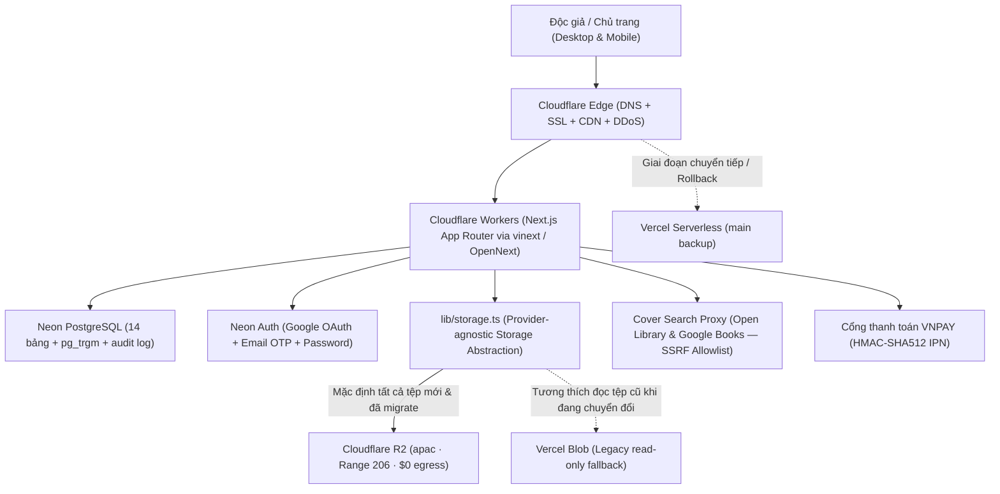

# Kiến trúc Hệ thống Lowf Library (Cloudflare + Neon PostgreSQL)

## 1. Mục tiêu kiến trúc

1. **Giải quyết triệt để điểm nghẽn dung lượng lưu trữ** (Vercel Blob Hobby giới hạn 1 GB và khóa `HTTP 503` toàn cục khi vượt mức) bằng **Cloudflare R2** (10 GB miễn phí mỗi tháng, `$0.015/GB` vượt mức, **$0 chi phí băng thông egress**).
2. **Bảo toàn 100% cơ sở dữ liệu quan hệ & xác thực** trên **Neon PostgreSQL + Neon Auth** — không di chuyển sang D1 vì hệ thống đang phụ thuộc JSONB, `pg_trgm`, `unaccent`, `lowf_orders` transactional VNPAY và Neon Auth JWT/cookie sessions.
3. **Sẵn sàng vận hành compute trên Cloudflare Workers** với `nodejs_compat`, `placement: { mode: "smart" }` (tự đặt Worker gần Neon PostgreSQL để giảm độ trễ DB), loại bỏ toàn bộ biến phụ thuộc riêng của Vercel (`VERCEL_ENV`, `VERCEL_URL`) và phụ thuộc ghi/đọc hệ thống tệp cục bộ lúc runtime.
4. **Tách biệt hoàn toàn Production & Staging** — bucket R2 riêng (`lowf-library-media` vs `lowf-library-staging-media`), biến môi trường riêng, nhánh Git riêng (`main` vs `migration/cloudflare`), không có bất kỳ bước tự động ghi đè Production nào.

---

## 2. Sơ đồ kiến trúc tổng thể

---

## 3. Luồng dữ liệu trọng yếu

### 3.1. Luồng phân phối sách PDF & Ảnh bìa (`GET /api/assets/[id]`)
1. Xác thực UUID và truy vấn metadata tệp trong `lowf_assets`.
2. Kiểm tra quyền đọc trên server (`authorizeAssetRead`):
   - **Ảnh bìa công khai / ảnh hero đã xuất bản:** đánh dấu `isPublic = true`, stream trực tiếp qua Edge CDN với `Cache-Control: public, max-age=604800, s-maxage=2592000, stale-while-revalidate=86400`.
   - **PDF / Audio / Video miễn phí hoặc riêng tư (member / đã mua):**
     - Nếu client gửi header `Range: bytes=...` và tệp nằm trên **Cloudflare R2**, server chuyển tiếp đúng dải byte và trả **`HTTP 206 Partial Content`** kèm `Accept-Ranges: bytes`, `Content-Range`, `Content-Length`, `Cache-Control: private, no-store`, `Vary: Cookie`.
     - Nếu yêu cầu tải trực tiếp lớn không kèm Range, server cấp **Presigned GET URL ngắn hạn (300 giây)** tới Cloudflare R2 (`302 Redirect`) để Worker không phải giữ kết nối lâu cho tệp hàng chục MB.
3. Phía trình duyệt (`public/media.js`): PDF.js được cấu hình `disableAutoFetch: true`, `disableStream: false`, `disableRange: false`, `rangeChunkSize: 262144` (256 KB/chunk) — giúp mở ngay trang 1 của sách PDF 30–50 MB chỉ sau ~250–500 KB truyền tải thay vì tải toàn bộ file.

### 3.2. Luồng tải lên trực tiếp R2 (`POST /api/uploads/presign` → `PUT R2` → `POST /api/uploads/finalize`)
- Admin gửi metadata tệp (`kind`, `contentType`, `byteSize`, `originalName`) → Server kiểm tra quyền Admin, giới hạn dung lượng (`image <= 5 MB`, `pdf <= 50 MB`, `audio <= 50 MB`, `video <= 250 MB`), sinh đường dẫn an toàn và trả Presigned `PUT` URL của R2 (hết hạn 15 phút).
- Trình duyệt tải thẳng tệp lên R2 (không đi qua giới hạn body 4.5 MB của serverless function).
- Client gọi `POST /api/uploads/finalize` → Server gọi `HEAD` tới R2 xác minh kích thước & MIME thực tế rồi mới ghi bản ghi vào `lowf_assets`.

### 3.3. Cấu trúc khóa lưu trữ chuẩn trên R2
Hệ thống hỗ trợ đồng thời tiền tố di sản `r2/lowf/<ownerId>/<kind>/<uuid>.<ext>` và cấu trúc chuẩn mới:
- `books/pdf/<slug>.pdf` — tệp sách PDF gốc (private, truy cập qua phân quyền server).
- `books/epub/<slug>.epub` — bản lưu trữ EPUB gốc (private, nếu lưu nguyên file).
- `covers/original/<slug>.<ext>` — ảnh bìa gốc chất lượng cao.
- `covers/card/<slug>.webp` — ảnh bìa tối ưu hiển thị thẻ sách (`<= 80 KB`).
- `covers/thumb/<slug>.webp` — ảnh bìa thu nhỏ danh sách (`<= 25 KB`).
- `assets/<uuid>.<ext>` — tài nguyên âm thanh, video, ảnh giao diện.

---

## 4. Kiến trúc dữ liệu (Neon PostgreSQL v2)

Bảo toàn toàn bộ 14 bảng hiện hữu (`lowf_content`, `lowf_assets`, `lowf_design_versions`, `lowf_profiles`, `lowf_user_state`, `lowf_posts`, `lowf_post_likes`, `lowf_rate_limits`, `lowf_payment_configs`, `lowf_orders`, `lowf_entitlements`, `lowf_payment_events`, `lowf_reader_annotations`, `lowf_reader_vocab`) và bổ sung an toàn qua [scripts/db-migrate-v2.sql](../scripts/db-migrate-v2.sql):
- Mở rộng trạng thái nội dung thành **7 trạng thái biên tập**: `draft`, `processing`, `needs_review`, `ready`, `published`, `archived`, `failed`.
- Bổ sung cột `sha256` & `storage_backend` cho `lowf_assets` để kiểm tra toàn vẹn tệp và tách bạch `r2` vs `vercel-blob`.
- Bổ sung chỉ mục `pg_trgm` (`gin_trgm_ops`), `sortOrder`, `category`, `isbn`, `checksumSha256` phục vụ tìm kiếm tiếng Việt không dấu phân trang qua `GET /api/books` cho quy mô 1.000–50.000 cuốn.
- Bổ sung bảng `lowf_admin_audit_log` lưu vết thao tác quản trị quan trọng.

---

## 5. Khung đánh giá Adapter Cloudflare Workers (`vinext` vs OpenNext)

| Tiêu chí | `vinext` (Khuyến nghị ưu tiên — Cloudflare chính thức) | `@opennextjs/cloudflare` (Phương án dự phòng) |
| --- | --- | --- |
| Tương thích Next.js 16.4.6 App Router | Cao, bundle gọn trên Vite + Workers | Ổn định, hỗ trợ đầy đủ Node APIs |
| Tốc độ cold start & kích thước Worker | Rất nhỏ (~1–2 MB gzip) | Lớn hơn (~3–6 MB) |
| Rủi ro cần kiểm chứng tại Staging CI | Kiểm tra tương thích `@neon/auth/next/server` trên Vite/Workers | Đã có nhiều ứng dụng production dùng BetterAuth/Neon Auth |

Cấu hình `wrangler.jsonc` và `.github/workflows/ci-staging.yml` đã sẵn sàng kiểm chứng thực tế `vinext` ngay trên nhánh `migration/cloudflare` trong môi trường Node 24 CI, và chuyển đổi sang `@opennextjs/cloudflare` không cần sửa logic nghiệp vụ nếu phát sinh bất kỳ khác biệt edge nào.
